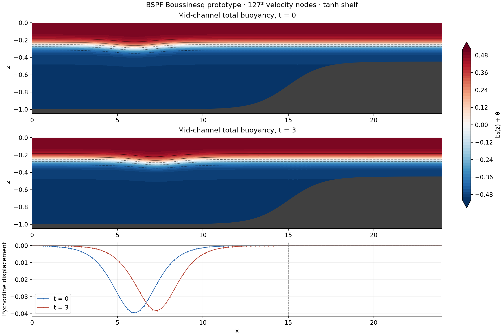

# 127³ internal-wave propagation preview

Mid-channel total buoyancy and pycnocline displacement at nondimensional times
**t=0** and **t=3**. The wave travels from the deep side toward the shelf
transition centered at x=15. This preview shows initial propagation; the wave
has not yet reached the shelf transition.

The GPU Boussinesq prototype uses the accepted mixed BSPF formulation with
127³ velocity nodes, 125³ pressure nodes, 191³ Gauss points, FP64 arithmetic,
and timestep 0.01. The domain has length 24, width 4, deep depth 1 and shelf
depth 0.45. The initial depression amplitude is -0.04, centered at x=6.
Stationary no-slip walls and a streamwise end sponge bound the tank; the
background stratification is maintained. The KdV-based initial pulse includes
wall tapers and a small transverse perturbation, and is not an exact DJL wave.

Source: Leonardo job 64685983, saved step-300 section, compared with the initial
section from validation job 64685639. Rendered on 2026-11-17. The preview is
not evidence of a completed shelf interaction or spatially converged mixing.

## Completed t=30 3D movie

[Download the 100-frame 3D MP4](internal_wave_t30.mp4)

The movie covers t=0 through t=30 using 100 actual three-dimensional buoyancy
snapshots from the 127³ simulation (Leonardo job 64691260). It shows the
background-pycnocline buoyancy isosurface over the tanh shelf, colored by its
height relative to the initial pycnocline. Vertical scale is exaggerated 4×.
The video is 1280×720 H.264, 10 fps, 10 seconds; decoded frame count was verified.
Rendering job: 64691584.

The FP64 run completed 3,000 steps with LSC pressure preconditioning: 6–14
coupled iterations (median 7), median 0.331 s/step. All checked true momentum,
continuity and scalar residuals stayed below 1e-10. Independent q=199 and q=207
final quadrature audits agreed. Visualization snapshots alone use float32.
This completed trajectory does not establish spatial convergence or resolved
wave breaking/mixing.
